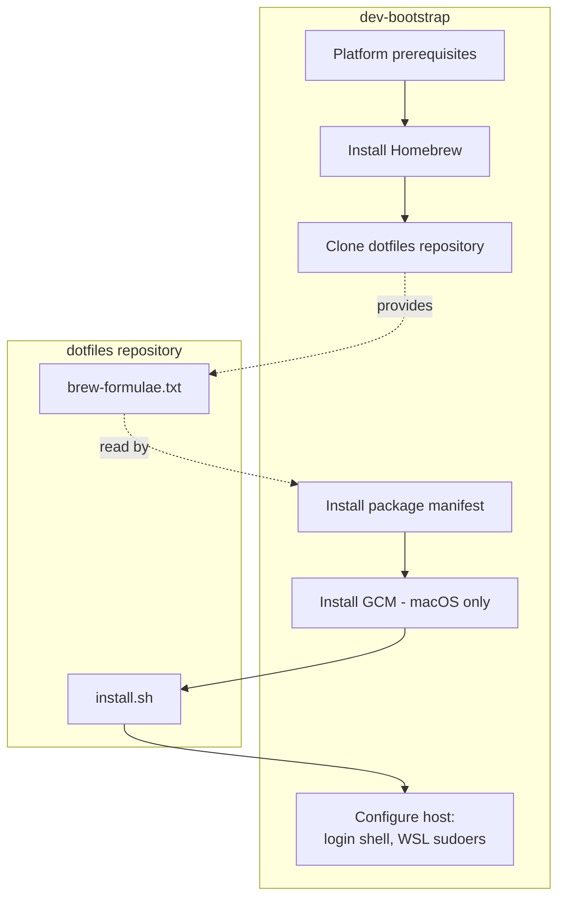

# Architecture

This document explains how `dev-bootstrap` is designed: the boundaries it
keeps, the lifecycle it runs, and the invariants future changes should
preserve. For installation commands, see [README.md](README.md).

## Purpose and Scope

`dev-bootstrap` takes a relatively fresh macOS or WSL machine to the point
where a dotfiles repository's desired state is installed on it. It owns
provisioning and convergence toward that state; user-level package
selection and development-tool configuration remain owned by the
dotfiles repository it acquires and invokes.

## System Boundaries

`dev-bootstrap` owns:

- platform prerequisites (Xcode Command Line Tools, WSL `apt` packages)
- installing Homebrew
- acquiring the dotfiles repository
- installing the package manifest the dotfiles repository declares
- Git Credential Manager on macOS
- invoking the dotfiles repository's installer
- host configuration that requires root: the default login shell and a WSL
  sudoers drop-in

The dotfiles repository owns:

- its package manifest (`brew-formulae.txt`)
- all configuration it installs
- its own installer (`install.sh`)
- platform-specific integration, such as the WSL Git credential helper path

Git for Windows owns Git Credential Manager on WSL; `dev-bootstrap` does not
install or configure it there (see
[Windows and WSL Integration](#windows-and-wsl-integration)).

This split keeps the dotfiles repository usable on its own, without
`dev-bootstrap`, and keeps `dev-bootstrap` generic over any dotfiles
repository that honors the contract in
[Dotfiles Integration](#dotfiles-integration).

## Bootstrap Lifecycle

Stage order encodes dependency, not sequence for its own sake. Homebrew
must exist before anything installs through it. The package manifest
installs before `install.sh` runs, so tools the installer expects (Stow,
language runtimes) are already present. The dotfiles repository is cloned
before Git Credential Manager is installed, so the clone itself cannot
depend on that installation and must succeed with whatever Git
authentication is already available. Host configuration runs last
because it depends on packages the dotfiles repository may have just
installed, such as fish.

## Platform Model

| Stage | macOS | WSL | Generic Linux |
|---|---|---|---|
| Prerequisites | Xcode CLT (installs, then exits for a re-run) | `apt` packages via sudo | none; warns and continues |
| Git Credential Manager | Homebrew cask | not installed by this script | not installed by this script |
| Login shell | `chsh` to fish, if installed | `chsh` to fish, if installed | `chsh` to fish, if installed |
| Sudoers drop-in | not written | `EDITOR`/`VISUAL` preserved across sudo | not written |

Platform detection distinguishes only macOS, WSL, and everything else
(`uname` for macOS, `/proc/version` for WSL). Generic Linux is best-effort:
it receives no prerequisite installation and a warning that the script
targets macOS and WSL. Behavior is not expected to be identical across
platforms; where it differs, that difference is intentional rather than a
gap to close.

## Dotfiles Integration

`DOTFILES_REPO` is an extension point: any Git repository that satisfies
this contract can stand in for the default. To work with `dev-bootstrap`,
a dotfiles repository must provide:

- a repository cloneable using whatever Git authentication is already
  available before bootstrap runs; the clone happens before `dev-bootstrap`
  installs or configures Git Credential Manager, so it cannot depend on
  that installation
- an optional `brew-formulae.txt` at its root, one Homebrew formula name
  per line, with no comment syntax
- an optional executable `install.sh` at its root, runnable with no
  arguments as the invoking user, and safe to run repeatedly

Including `fish` in the package manifest is what causes `dev-bootstrap` to
change the user's login shell to it; `dev-bootstrap` does not otherwise
know or care what the manifest contains.

## Idempotence and Privilege

The bootstrap is designed to be safe to re-run. Most stages detect
existing state explicitly before acting: an existing Xcode CLT install, a
`brew` already on `PATH`, an existing clone directory, an existing login
shell, an existing sudoers file. The package and dotfiles install stages
have no such check; they re-invoke `brew install` and `install.sh` on
every run and rely on those operations being safe to repeat rather than
detecting prior completion themselves. Re-running the script after a
partial or failed run is the expected recovery path either way, including
the case where the macOS Xcode CLT stage must exit so the user can finish
an interactive installer.

These checks establish state if it is absent; they do not reconcile it.
An existing clone is never updated against `DOTFILES_REPO`, and an
existing sudoers drop-in is never diffed against its expected content.

The script runs as the invoking user. It escalates to `sudo` only for
actions that require root: installing WSL `apt` packages, the first
Homebrew install, changing the login shell, and writing the sudoers
drop-in. Sudo credentials are cached up front for a stage before the
first privileged command in it, because the Homebrew installer runs
non-interactively and cannot itself prompt. Sudoers content is validated
with `visudo` before being installed. `--dry-run` never caches credentials
or escalates.

## Windows and WSL Integration

On WSL, Git Credential Manager is not installed by `dev-bootstrap`; it is
provided by Git for Windows on the host and shared into WSL, which is why
the platform table above shows no WSL Git Credential Manager stage.

`git-install.inf` is an InnoSetup response file that makes the Windows-side
Git for Windows installation reproducible via `/LOADINF`, including
enabling the credential manager that WSL then relies on. It captures
installer choices, not application behavior; its own header documents how
to regenerate it. This repository does not reproduce or track its
individual settings here.

## Configuration and Extension Points

- `DOTFILES_REPO` is the architectural extension point: pointing it at a
  different repository that satisfies the
  [dotfiles contract](#dotfiles-integration) retargets the whole bootstrap.
- `DOTFILES_DIR` is supported operational configuration. Its default path
  is not architecturally significant.
- `BREW_FORMULAE_FILE` may be pointed at an arbitrary file as an
  operational override, but this is not a second desired-state model: the
  architecture is that the package manifest comes from the acquired
  dotfiles repository.
- Command-line flags (`--dry-run`, `--skip-dotfiles`, `--skip-packages`)
  are operational; see `bootstrap.sh --help`.

## Architectural Invariants

- The bootstrap is a single file, fetchable and runnable in one step
  (`bash -c "$(curl ...)"`), and must run under the Bash shipped with
  stock macOS.
- Every stage is safe to re-run, through explicit state checks or
  idempotent underlying operations.
- All state-changing operations honor `--dry-run`: ordinary commands
  through the `run`/`run_sh`/`run_eval` wrappers, sudoers changes through
  `sudoers_write`, and any other direct mutation only if it implements
  its own dry-run check.
- User-level package selection and development-tool configuration stay in
  the dotfiles repository; `dev-bootstrap` owns machine provisioning and
  the bootstrap-specific host integration described in
  [System Boundaries](#system-boundaries).
- `sudo` is used only where the action requires root; everything else runs
  as the invoking user.
